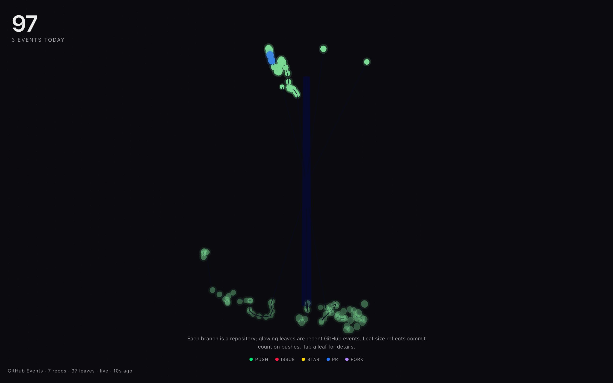

<div align="center">

<h1>branch</h1>

<p><b>A GitHub activity feed grown into a 3D tree.</b></p>

<p><i>Every repo is a branch off one trunk, every push, pull request, issue, star and fork a glowing leaf, with older activity lower down.</i></p>

<h6>


</h6>

<a href="https://branch.parthchandak.info"><b>Live demo</b></a> ·
<a href="#how-it-works"><b>How it works</b></a> ·
<a href="#run-it"><b>Run it</b></a>

<br><br>

<a href="https://branch.parthchandak.info"></a>

<sub>Live capture, 22 October 2026, zoomed out to the whole tree. Real public GitHub events: 97 leaves across 7 repos.</sub>

</div>

<br>

A React Three Fiber scene built from the public
[GitHub Events API](https://docs.github.com/en/rest/activity/events) for one account
(`parthchandak02`). It pulls the latest 100 events every five minutes, keeps the five kinds
worth seeing, and grows them into a tree that slowly turns. No token is needed: that is 12 of
GitHub's 60 unauthenticated requests an hour per visitor IP.

## How it works

| Event data | Drives |
|---|---|
| `repo.name` | One curved branch per repo, at an angle hashed from the name |
| `created_at` | Height on the tree, from the oldest event at the bottom to the newest at the top, and leaf brightness (older is dimmer) |
| `type` | Leaf colour: green push, blue pull request, red issue, gold star, purple fork |
| Commits in a push | Leaf size, up to eight commits |

Branches grow out from the trunk with a staggered ease-out when the page loads. Drag to orbit,
scroll to zoom. Click a leaf for a panel with its type, repo, age, commit count or PR and issue
title, and a link to the repo; it fades after a few seconds.

If a refresh fails, the events already on screen stay and the stamp in the bottom-left adds the
reason, for example `live (rate-limited until 14:05)`; when GitHub reports the hourly limit is
spent, the next request waits for the reset time. If nothing has loaded yet, the tree shows ten
made-up sample events and the stamp reads `sample data`.

## Run it

```bash
git clone https://github.com/parthchandak02/branch.git
cd branch
npm install
npm run dev      # local dev server
npm run build    # static site in dist/
```

To grow a tree for a different account, change the username in the fetch URL in
`src/data/events.ts`. The live version runs on Cloudflare Pages.

<details>
<summary><b>Project layout</b></summary>

```
src/data/events.ts            Fetch, event parsing, sample fallback, poll interval
src/components/BranchTree.tsx Trunk, branches, leaves, growth animation and rotation
src/components/Background.tsx Dark background and faint dot grid
src/components/Chrome.tsx     Hero count, data stamp, description and legend
src/components/QuietZone.tsx  Leaf detail panel (Motion)
src/store.ts                  Zustand store for events, selection and stats
brief.md                      The original creative brief
```

</details>

<br>

<div align="center">
<sub>Built with React Three Fiber, drei, Three.js, Motion, Zustand and Vite. Data from the GitHub Events API.</sub>
</div>
